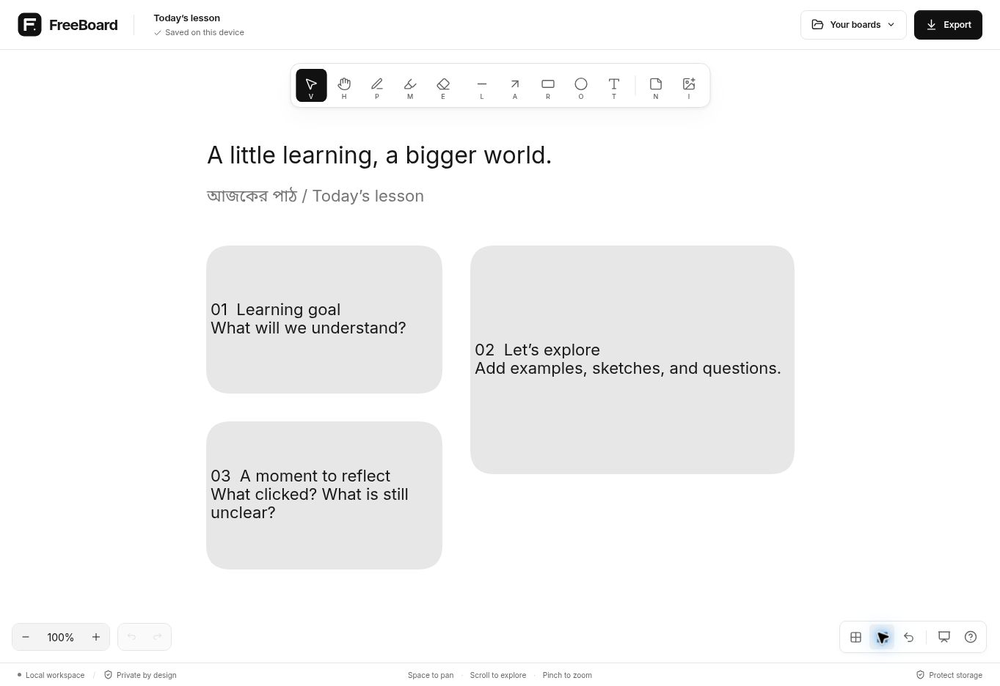
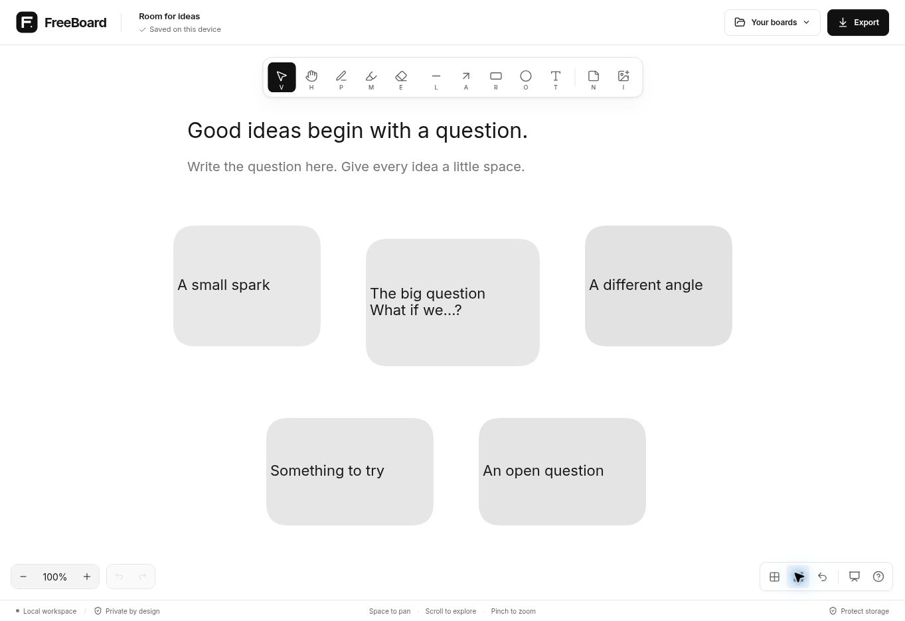
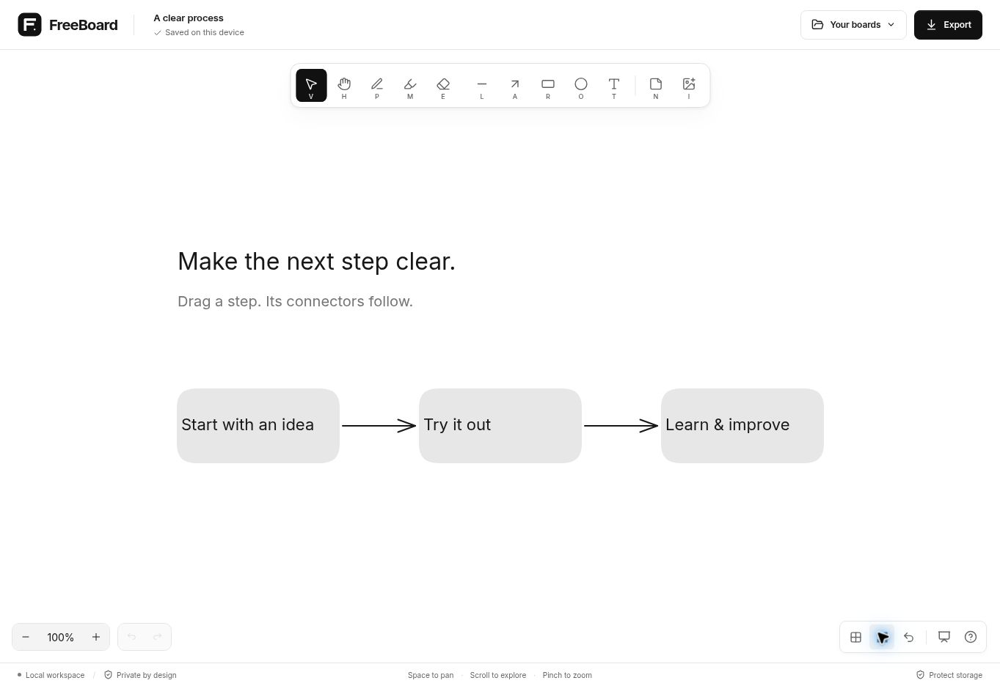

<div align="center">


# FreeBoard

**Make space for ideas.**

A private, open-source whiteboard for lessons, sketches, and clearer thinking.
Open your browser and start. No account, payment, API key, or backend required.

[**Open FreeBoard ↗**](https://ataullha.github.io/FreeBoard/) · [User guide](docs/USER_GUIDE.md) · [Contribute](CONTRIBUTING.md) · [Report a bug](https://github.com/Ataullha/FreeBoard/issues)

[](https://github.com/Ataullha/FreeBoard/actions/workflows/ci.yml)
[MIT licensed](LICENSE)

</div>



## A clear workspace

- **Write and draw.** Pressure-sensitive stylus ink, adjustable pen and marker width sliders, shapes, attached arrows, multiline text, sticky notes, and local images.
- **Keep editing.** Multiple selection, resize, rotate, group, lock, layering, copy/paste, a hold-to-grow mouse eraser, undoable Clear board, and undo/redo.
- **Make it yours.** A restrained black-and-white interface, bundled Inter typography, Bengali text support, a small local clock beside zoom, useful shortcuts, and responsive controls.
- **Keep your work nearby.** IndexedDB autosave, recoverable trash, interrupted-session recovery, board thumbnails, and protection against stale writes from another tab.
- **Take your ideas with you.** Editable JSON backups, PNG and SVG exports, selection export, and transparent backgrounds.
- **Use it offline.** Installable PWA with locally bundled runtime assets. Updates wait for you to save and restart.

The lesson, brainstorming, and flowchart starters are ordinary editable objects. There is no cloud account, cloud synchronization, or live collaboration service.

### Real application previews

| Brainstorming                                                                | Connected flowchart                                                       |
| ---------------------------------------------------------------------------- | ------------------------------------------------------------------------- |
|  |  |

These are screenshots of the running application, not mockups.

## Run locally

Use **Node.js 24 LTS** and npm; Node.js 22.12+ is supported.

```sh
git clone https://github.com/Ataullha/FreeBoard.git
cd FreeBoard
npm ci
npm run dev
```

Open the local URL Vite prints, usually `http://localhost:4173`.

| Command                | What it does                                                         |
| ---------------------- | -------------------------------------------------------------------- |
| `npm run dev`          | Start development with local runtime assets                          |
| `npm run format:check` | Check source formatting                                              |
| `npm test`             | Run model, pen-input, history, storage, validation, and worker tests |
| `npm run check`        | Type-check, test, and build                                          |
| `npm run build`        | Generate the static production app in `dist/`                        |
| `npm run preview`      | Serve the production build on port 4173                              |
| `npm run package`      | Package source and deployment ZIPs after building                    |

Serve `dist/` over HTTP/HTTPS rather than opening its HTML file directly. Offline installation requires HTTPS or a trustworthy localhost origin; development intentionally does not register a worker.

## Your work, your browser

Board contents and images stay in this browser profile. FreeBoard has no analytics, tracking scripts, accounts, or board-upload service. Hosting providers still receive ordinary website requests; see [privacy information](docs/PRIVACY.md).

**Browser storage can be cleared. Download editable backups of important work.** Use **Export → Editable backup** to preserve objects, text, and images together. A different browser, device, or website origin has separate storage. “Saved on this device” appears only after the storage transaction succeeds. Recovery cannot guarantee the last unsaved input before a crash.

The FreeBoard rename preserves the original database and preference keys. Legacy BoardPilot v1/v2 backups remain importable. The application is hosted at `/FreeBoard/`; the earlier `/FreePod/` deployment and redirect have been removed. Saved boards stay in the same browser storage.

## Build and deploy

FreeBoard builds to static files. No secrets or environment variables are needed.

The live deployment is [ataullha.github.io/FreeBoard/](https://ataullha.github.io/FreeBoard/), linked from the owner's portfolio. Its deployment workflow lives in [Ataullha/ataullha.github.io](https://github.com/Ataullha/ataullha.github.io/blob/main/.github/workflows/pages.yml) and builds this repository. A source-only update needs that workflow to be run again. This repository's CI checks changes and retains `dist` as a build artifact.

See [deployment instructions](docs/DEPLOYMENT.md) for GitHub Pages, Cloudflare Pages Git integration, direct upload, subdirectory hosting, and safe PWA updates.

## Engineering and verification

React, TypeScript, and Vite provide the application shell. The MIT-licensed Excalidraw engine owns object editing, history, connectors, and exports. A separate pen-input adapter buffers coalesced pressure samples and renders active ink without a React update or scene traversal for every sample. Each completed stroke becomes a native editable object and one history action. Storage waits for pen idle rather than writing on every pen lift.

**This is a release candidate.** Automated and browser checks are documented with actual measurements in the [verification report](docs/VERIFICATION.md). Remote Chromium tests cover pen/palm event routing, sample retention, undo/redo, export, reload, and recovery. Physical stylus latency and pressure feel still need target-device testing; Safari, Firefox, and mobile hardware are not certified.

| Documentation                        | Purpose                                                 |
| ------------------------------------ | ------------------------------------------------------- |
| [User guide](docs/USER_GUIDE.md)     | Tools, shortcuts, backups, and offline use              |
| [Architecture](docs/ARCHITECTURE.md) | Editor adapter, documents, storage, and data safety     |
| [Design](docs/DESIGN.md)             | Typography, colors, and interface decisions             |
| [Verification](docs/VERIFICATION.md) | Repeatable checks, performance records, and limitations |
| [Dependencies](docs/DEPENDENCIES.md) | Dependency choices and license review                   |
| [Launch copy](docs/LAUNCH.md)        | Product description and announcement text               |

## Contribute

Everyone is welcome to use, fork, inspect, and improve FreeBoard. Bug reports, reproducible device/input issues, accessibility improvements, translations, documentation, and pull requests all help.

Read [CONTRIBUTING.md](CONTRIBUTING.md) for setup and checks, follow the [Code of Conduct](CODE_OF_CONDUCT.md), and use [SECURITY.md](SECURITY.md) for security reports. When reporting a pen issue, include your device, stylus model, operating system, browser version, and whether palm contact changes the behavior. Please avoid attaching private board content.

## License and acknowledgments

FreeBoard is released under the [MIT license](LICENSE). Excalidraw and other bundled dependencies retain their own licenses and attribution. Inter and Noto Sans Bengali are bundled under the SIL Open Font License. See [third-party notices](THIRD_PARTY_NOTICES.txt), [dependency notes](docs/DEPENDENCIES.md), and [license texts](docs/licenses/).
